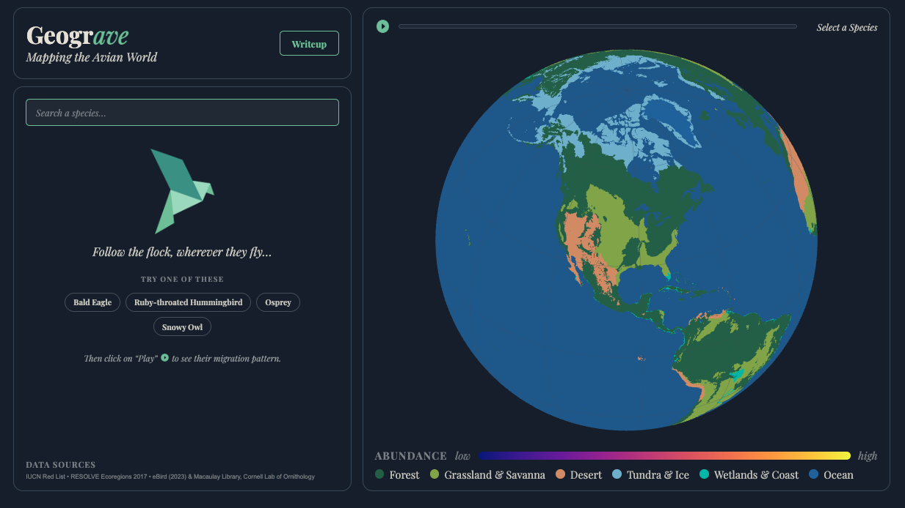
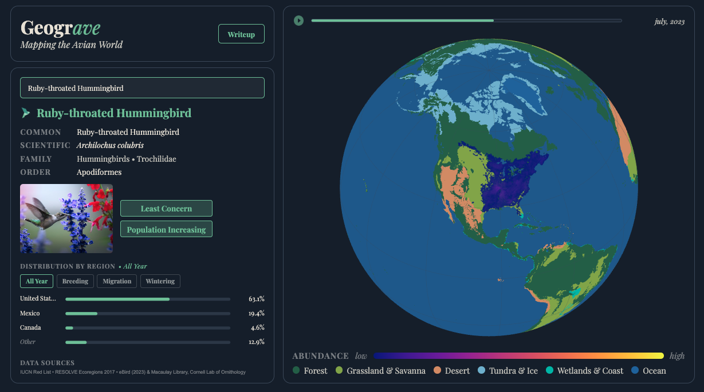

# 🦅 GeoGrave

**An interactive visualization exploring how bird abundance changes across geography, seasons, and time.**

### 🌎 Explore

[**Launch the interactive visualization →**](https://cse512.pages.cs.washington.edu/26sp/a3/geograve/)

### 🗺️ About

GeoGrave is an interactive data visualization for exploring patterns in bird abundance across space and time. Users can search for individual species and explore how their estimated abundance changes geographically and throughout the year.

The visualization combines an interactive globe with an animated weekly timeline, allowing users to examine seasonal and regional patterns for selected bird species.

### 🖥️ Technologies & Methods

- JavaScript and D3.js
- Interactive geographic data visualization
- Temporal animation of weekly abundance data
- Geographic coordinate and projection processing
- Large-scale ecological data preprocessing

### 🚀 Team & Contributions

- **Samantha Eaton** — data collection, preprocessing, and UX design
- **Baback Elmieh** — application development and website implementation
- **Julio Chavez** — application development and website implementation

GeoGrave was developed as a collaborative project for **CSE 512: Data Visualization** at the **University of Washington's Paul G. Allen School of Computer Science & Engineering** (Spring 2026). The project was originally developed through the University of Washington's course GitLab, with the original development history preserved in this repository.

### 📗 Data & References

GeoGrave primarily uses bird abundance data from **eBird Status and Trends**, along with supporting biome geometry and species metadata.

Additional methodology, data sources, and references are documented within the project.
